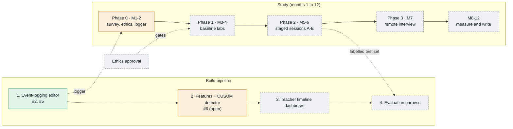

# Project status

Last updated: **2026-10-26**. Live page: <https://claude.ai/artifact/7nwKBLuR3yH3HDyJ3588Bd>
(private; its source is [`phase-diagram.html`](phase-diagram.html)). The same picture for the
thesis is the TikZ figure [`latex/flowcharts/phase-progress.tex`](../latex/flowcharts/phase-progress.tex),
shown in appendix E.

**Keep these in step.** When a PR finishes or changes a tracked item, update this file,
the data block at the bottom of `phase-diagram.html`, and the TikZ figure in the same PR,
then republish the page to the same link.

Legend: ✅ done · 🟧 in progress · ⬜ pending

## Build pipeline

| Step | Item | Status | PR |
| --- | --- | --- | --- |
| 1 Editor | Keystroke, paste, edit, cursor, focus and run logging (event schema v1) | ✅ | #2 |
| 1 Editor | FastAPI + SQLite backend, Python runner, export and replay | ✅ | #2 |
| 1 Editor | Student UI redesign (React, Tailwind, Motion) | ✅ | #5 |
| 2 Detector | Synthetic session generator (60 simulated typists) | 🟧 | #6 |
| 2 Detector | Habit features per 30 s window | 🟧 | #6 |
| 2 Detector | Two-channel CUSUM (identity, process) | 🟧 | #6 |
| 2 Detector | Rework structural build-order features | 🟧 | #6 |
| 2 Detector | Calibrate alarm threshold on more typists | ⬜ | |
| 3 Dashboard | Evidence timeline per session (alarms, switch estimate, channel) | ⬜ | |
| 3 Dashboard | Review view leading to a conversation, never a penalty | ⬜ | |
| 4 Evaluation | Replay staged sessions A to E | ⬜ | |
| 4 Evaluation | Baselines: scaled Manhattan, TypeNet-style, Nosi rhythm | ⬜ | |
| 4 Evaluation | Fairness by subgroup; precision at 1/100 and 1/500 | ⬜ | |

Detector, synthetic first pass (seed 7, 60 typists): 75% of matched takeovers caught, 86 s
median delay, 0.42 false alarms per honest hour, 50% of copying caught.

## Study timeline

| Phase | Months | Item | Status |
| --- | --- | --- | --- |
| 0 | 1-2 | Build the logger | ✅ (#2) |
| 0 | 1-2 | Student survey | ⬜ |
| 0 | 1-2 | Ethics approval (gates all real data collection) | ⬜ |
| 1 | 3-4 | Baseline labs, 60 to 80 volunteers; per-student baselines | ⬜ |
| 2 | 5-6 | Staged conditions A honest, B proxy, C takeover, D copying, E paste; grade-matched proxies | ⬜ |
| 3 | 7 | Mock remote interview on own laptop, 20 to 30 people | ⬜ |
| — | 8-12 | Run the evaluation, write up RQ1 to RQ4 | ⬜ |

## Thesis groundwork

| Item | Status | PR |
| --- | --- | --- |
| Thesis folder: brain log and LaTeX project | ✅ | #1 |
| Related work; Nosi IDE details confirmed from the paper | ✅ | #3 |
| Chapter drafts (related work drafted, others scaffolded) | 🟧 | |
| Official IIIT Surat thesis template | ⬜ | |
