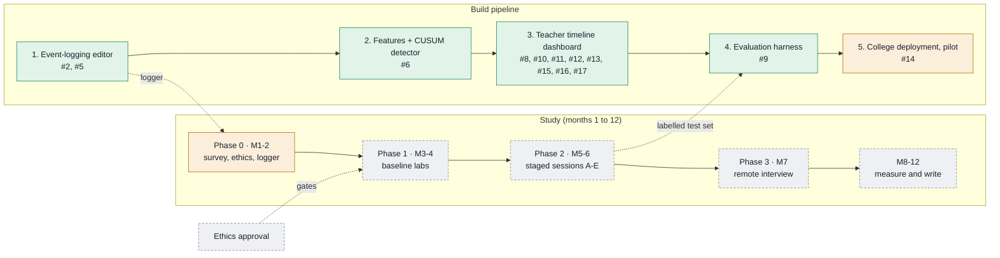

# Project status

Last updated: **2026-10-27**. Live page: <https://claude.ai/artifact/7nwKBLuR3yH3HDyJ3588Bd>
(private; its source is [`phase-diagram.html`](phase-diagram.html)). The same picture for the
thesis is the TikZ figure [`latex/flowcharts/phase-progress.tex`](../latex/flowcharts/phase-progress.tex),
shown in appendix E.

**Keep these in step.** When a PR finishes or changes a tracked item, update this file,
the data block at the bottom of `phase-diagram.html`, and the TikZ figure in the same PR,
then republish the page to the same link.

Legend: ✅ done · 🟧 in progress · ⬜ pending

## Build pipeline

| Step | Item | Status | PR |
| --- | --- | --- | --- |
| 1 Editor | Keystroke, paste, edit, cursor, focus and run logging (event schema v1) | ✅ | #2 |
| 1 Editor | FastAPI + SQLite backend, Python runner, export and replay | ✅ | #2 |
| 1 Editor | Student UI redesign (React, Tailwind, Motion) | ✅ | #5 |
| 2 Detector | Synthetic session generator (60 simulated typists) | ✅ | #6 |
| 2 Detector | Habit features per 30 s window | ✅ | #6 |
| 2 Detector | Two-channel CUSUM (identity, process) | ✅ | #6 |
| 2 Detector | Rework structural build-order features | ✅ | #6 |
| 2 Detector | Key-pair timing channel (per-digraph latency, chosen on dev) | ✅ | #10 |
| 3 Dashboard | Evidence timeline per session (alarms, switch estimate, channel) | ✅ | #8 |
| 3 Dashboard | Review view leading to a conversation, never a penalty | ✅ | #8 |
| 3 Dashboard | Code replay at any moment; simulated demo students | ✅ | #8 |
| 3 Dashboard | Timeline runs the frozen evaluated config (window lengths, prior, calibrated h) | ✅ | #10 |
| 3 Dashboard | Teacher authoring: labs, questions with starter code, rosters; every session linked to its lab and question | ✅ | #11 |
| 3 Dashboard | Class competitions: lobby, clock, test-graded submissions, live leaderboard (the one place correctness is scored) | ✅ | #12 |
| 3 Dashboard | Optional tests (ungraded Check in labs; required in competitions), lab subject and language (Python, C, C++, Java, JS), questions from platforms: Exercism live, LeetCode/HackerRank/CodeChef link only | ✅ | #13 |
| 3 Dashboard | Larger question sets by topic: Codeforces (4,551) and CodeChef (332) from the CC BY 4.0 CodeContests dataset with tests, MBPP (974 beginner Python) live; 19 shared topics | ✅ | #15 |
| 3 Dashboard | Live classroom view: class grid per open lab, read-only student editor; students always see who is watching, views logged, consent v2 | ✅ | #16 |
| 3 Dashboard | A lab opens as one sitting: question tabs in one editor, each question keeps its code (resumed in a later sitting); one session per question visited, linked by a sitting id | ✅ | #17 |
| 3 Dashboard | Competitions hand in each student's code when time runs out; leaderboard linked for owner, co-teachers and admins | ✅ | #21 |
| 3 Dashboard | Any-language competitions (each student picks the language per question) and a staff-only similar-submissions check (winnowing + tiling, side by side) | ✅ | #24 |
| 3 Dashboard | Always-open learning lab: C and Python lessons with runnable examples and checked exercises; practice recorded but kept out of baselines, detector and review | ✅ | #30 |
| 3 Dashboard | Learning lab filled out to a full syllabus (82 lessons: C, C++, Python beginner to advanced) and "View as student" for teachers and admins (previews never study data) | ✅ | #31 |
| 4 Evaluation | Harness: student-level dev/test split, frozen config, test ledger | ✅ | #9 |
| 4 Evaluation | Baselines: scaled Manhattan, TypeNet-style, Nosi rhythm | ✅ | #9 |
| 4 Evaluation | Calibrate alarm threshold (students' own baseline weeks) | ✅ | #9 |
| 4 Evaluation | Fairness by subgroup; precision at 1/100 and 1/500 | ✅ | #9 |
| 4 Evaluation | Run on the Phase 1-2 recordings (labels manifest) | ⬜ | |
| 5 Deployment | Google sign-in limited to @iiitsurat.ac.in; roles from the address format, admin override (People page) | ✅ | #14 |
| 5 Deployment | Raw keystrokes deleted after the 4-week baseline or 28 days, window summaries kept; erase a student on request | ✅ | #14 |
| 5 Deployment | Docker Compose: Caddy HTTPS, isolated code runner, nightly backups; deploy guide for an India-region VM | ✅ | #14 |
| 5 Deployment | Google OAuth client, VM and domain set up (Rohan) | ⬜ | |
| 5 Deployment | Pilot in a real lab (study data only after ethics approval) | ⬜ | |

Detector, synthetic results (seed 7, 60 typists): 72% of matched takeovers caught, 80 s
median delay, 80% of copying caught (after the build-order rework), 0.42 false alarms per honest hour.

Evaluation harness, synthetic test students (36, scored once per frozen config): with the key-pair
channel (#10) 92% of non-honest sessions caught at 0.19 false alarms per hour, matched takeovers 86%
(scaled Manhattan 89%, but blind to copying); precision of a flag about 12% at 1 in 100 prevalence.
The two-channel config of #9 gave 83%, 64% and 0.28.

Dashboard demo (6 simulated students, frozen config): 7 of 8 non-honest sessions got a moment to
discuss, none of the 4 honest ones and none of the 24 baseline-week sessions did.

## Study timeline

| Phase | Months | Item | Status |
| --- | --- | --- | --- |
| 0 | 1-2 | Build the logger | ✅ (#2) |
| 0 | 1-2 | Student survey | ⬜ |
| 0 | 1-2 | Ethics approval (gates all real data collection) | ⬜ |
| 1 | 3-4 | Baseline labs, 60 to 80 volunteers; per-student baselines | ⬜ |
| 2 | 5-6 | Staged conditions A honest, B proxy, C takeover, D copying, E paste; grade-matched proxies | ⬜ |
| 3 | 7 | Mock remote interview on own laptop, 20 to 30 people | ⬜ |
| — | 8-12 | Run the evaluation, write up RQ1 to RQ4 | ⬜ |

## Thesis groundwork

| Item | Status | PR |
| --- | --- | --- |
| Thesis folder: brain log and LaTeX project | ✅ | #1 |
| Related work; Nosi IDE details confirmed from the paper | ✅ | #3 |
| Chapter drafts (related work drafted, others scaffolded) | 🟧 | |
| Official IIIT Surat thesis template | ⬜ | |
